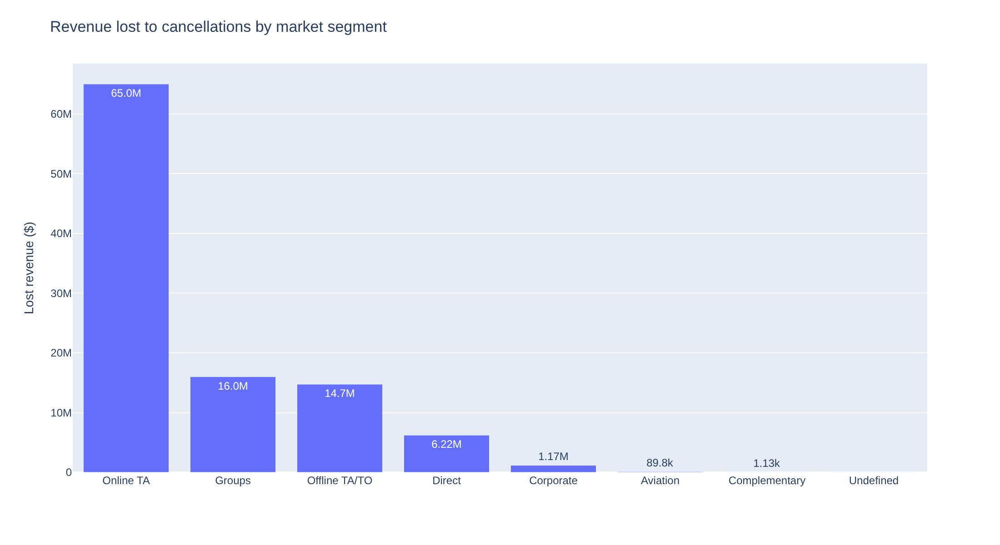
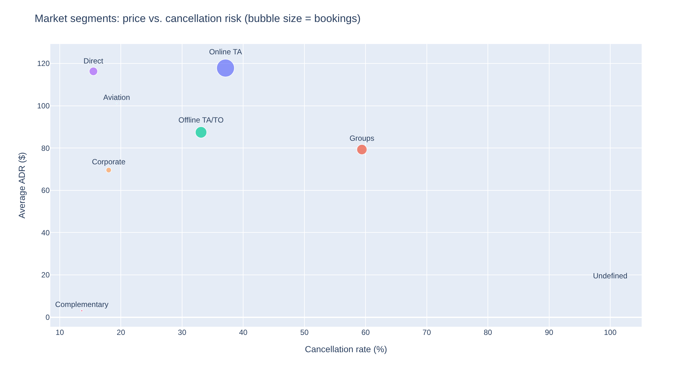
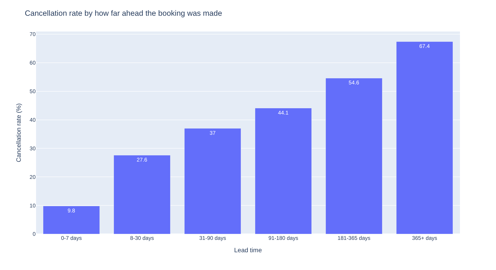
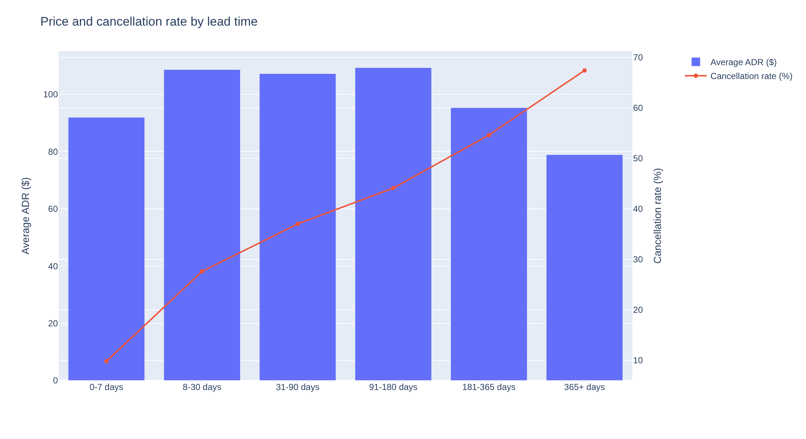
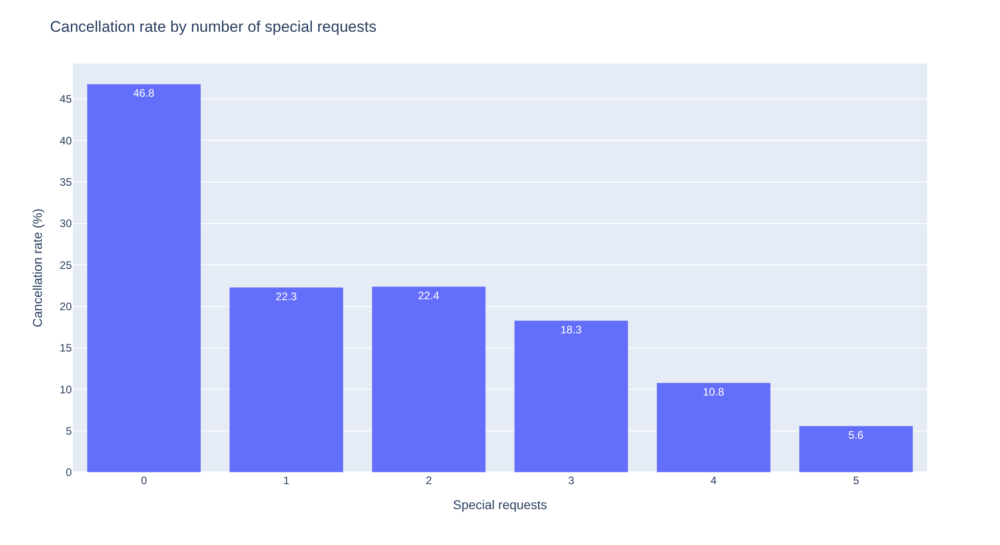
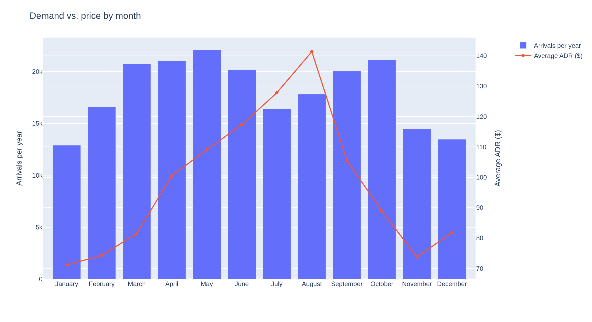
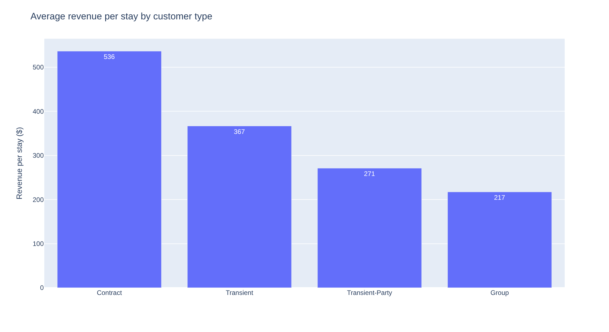
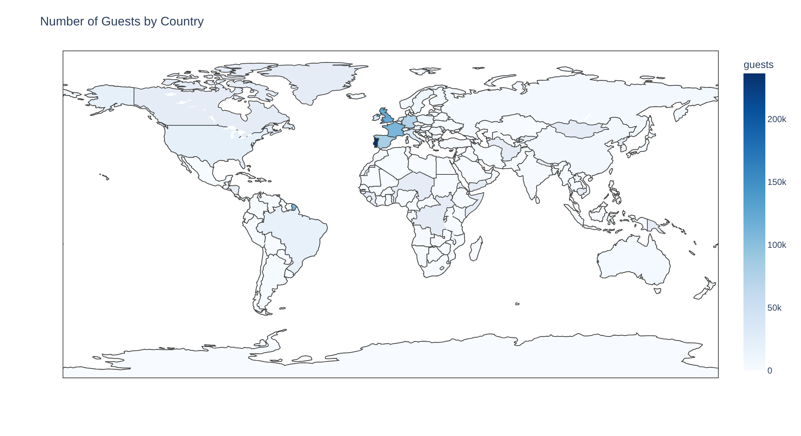
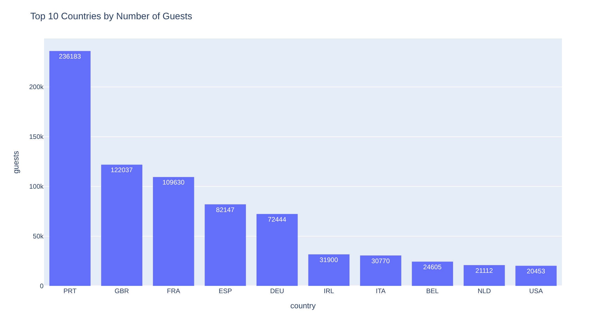
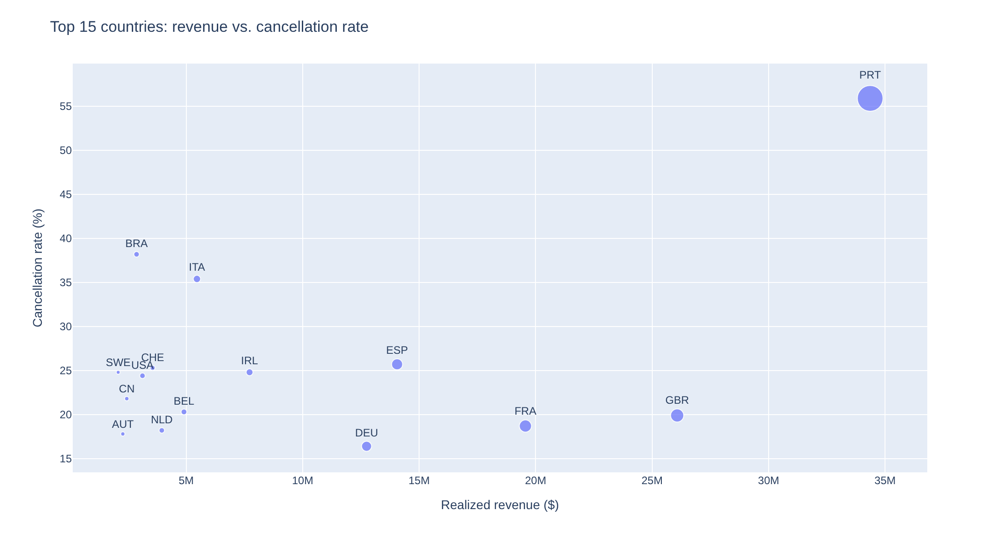

# Business Questions and Findings

*Hotel booking analysis: 736,272 bookings with arrival dates from July 2015 to August 2017. Revenue means room revenue (nightly rate × nights) and is shown in dollars, as labeled in the analysis.*

---

### Business Question 1: How much revenue do cancellations cost the hotel?

**What we did**

We counted how many bookings were canceled and added up the room revenue those bookings would have brought in, then compared it with the revenue from guests who actually stayed.

**Results**

| KPI | Value |
|---|---|
| Bookings | 736,272 |
| Cancellation rate | **36.5%** |
| Room revenue earned (guests who stayed) | **\$162,958,621** |
| Room revenue lost to cancellations | **\$103,237,503** |
| Share of all booked room revenue lost | **38.8%** |
| Of that, from "Non Refund" bookings (the hotel keeps the deposit) | \$20,294,830 |
| **Realistic loss** (excluding Non Refund bookings) | **about \$82,942,673** |

**What we learned**

More than 1 in 3 bookings is canceled. Those cancellations represent almost 4 of every 10 dollars of booked room revenue. Because non-refundable deposits are kept by the hotel, the true exposure is closer to \$83M than \$103M. Even that figure is an upper limit: it assumes every canceled room stayed empty, and some were probably resold.

**Business takeaway**

Cancellations are the single largest revenue problem in this data, and reducing them is worth tens of millions of dollars in booked revenue.

---

### Business Question 2: Which booking channels lose the most revenue to cancellations?

**What we did**

We compared each market segment (how the booking came in) on cancellation rate and revenue lost.

**Results**

| Market segment | Bookings | Cancellation rate | Revenue lost |
|---|---|---|---|
| Online Travel Agent (booking websites) | 354,953 | 37.1% | \$65.0M |
| Groups | 116,301 | **59.4%** | \$16.0M |
| Offline Travel Agent / Tour Operator | 146,993 | 33.1% | \$14.7M |
| Direct (hotel website or phone) | 78,969 | 15.5% | \$6.2M |
| Corporate | 32,883 | 18.0% | \$1.2M |

**What we learned**

- **Online Travel Agents cause 63% of all lost revenue.** Their cancellation rate (37.1%) is close to average; the loss is large because they bring almost half of all bookings.
- **Groups are the least reliable segment.** They cancel 59.4% of the time and lose more revenue (\$16.0M) than they actually bring in (\$11.5M).
- Direct bookings cancel the least among the large segments (15.5%).

**Business takeaway**

Two different problems need two different fixes: booking websites are a volume problem, and group bookings are a reliability problem.

---

### Business Question 3: Which channels are actually worth the most once cancellations are counted?

**What we did**

We plotted each segment's average nightly price against its cancellation rate. We also calculated **revenue per booking made**: revenue actually earned divided by all bookings, including canceled ones. This shows what one booking from a channel is really worth.

**Results**

*Top-left is best: high price, few cancellations.*

| Market segment | Avg nightly price | Cancellation rate | Revenue per booking made |
|---|---|---|---|
| Direct | \$116.28 | 15.5% | **\$323.97** |
| Aviation | \$101.17 | 19.3% | \$290.57 |
| Online Travel Agent | \$117.83 | 37.1% | \$243.15 |
| Offline Travel Agent / Tour Operator | \$87.43 | 33.1% | \$241.26 |
| Corporate | \$69.57 | 18.0% | \$110.22 |
| Groups | \$79.28 | 59.4% | \$98.99 |

By distribution channel, Direct bookings cancel 17.5% of the time compared with 40.4% for travel agents and tour operators.

**What we learned**

Direct and Online Travel Agent bookings are priced almost the same (\$116 vs \$118 per night). But because Direct guests cancel less than half as often, **each Direct booking is worth \$324 compared with \$243, or 33% more.** Looking at nightly price alone would make booking websites look like the best channel; they are not. Groups bring the least value per booking (\$99) because so many cancel.

The analysis did not include travel agent commissions, so the real gap between Direct and agent bookings is likely larger than shown.

**Business takeaway**

Direct bookings are the most valuable channel; moving guests toward booking direct raises earned revenue without raising prices.

---

### Business Question 4: Do bookings made further in advance cancel more often?

**What we did**

We grouped bookings by how many days ahead they were made (lead time) and compared cancellation rates and lost revenue.

**Results**

| Booked ahead | Bookings | Cancellation rate | Revenue lost |
|---|---|---|---|
| 0-7 days | 121,459 | **9.8%** | \$2.8M |
| 8-30 days | 119,097 | 27.6% | \$12.8M |
| 31-90 days | 182,488 | 37.0% | \$26.7M |
| 91-180 days | 164,194 | 44.1% | \$31.8M |
| 181-365 days | 130,737 | 54.6% | \$27.1M |
| More than 365 days | 18,297 | **67.4%** | \$2.0M |

**What we learned**

Cancellation risk rises at every step. A booking made more than a year ahead is almost 7 times as likely to cancel as one made in the last week. **Bookings made 91 or more days ahead are 42.5% of all bookings but 59% of lost revenue (\$60.9M).** The longer a reservation sits on the calendar, the more time the guest has to change plans or find another deal.

Some of this pattern may come from the type of guest (for example, groups tend to book early). The analysis compared one factor at a time, so it cannot fully separate these effects.

**Business takeaway**

How far ahead someone books is a simple, early warning sign of cancellation risk that the hotel knows at the moment of booking.

---

### Business Question 5: Do early bookers pay more or less?

**What we did**

We compared the average nightly price and the cancellation rate across the same lead-time groups.

**Results**

| Booked ahead | Avg nightly price | Revenue per booking made |
|---|---|---|
| 0-7 days | \$91.95 | \$169.48 |
| 8-30 days | \$108.65 | \$230.93 |
| 31-90 days | \$107.23 | \$240.26 |
| 91-180 days | **\$109.32** | **\$259.32** |
| 181-365 days | \$95.34 | \$204.22 |
| More than 365 days | \$78.90 | \$95.51 |

**What we learned**

Prices are highest for bookings made 91 to 180 days ahead. Even after counting their 44.1% cancellation rate, these bookings are worth the most per booking (\$259). Bookings made more than a year ahead are the opposite: the cheapest (\$79 per night) and the most likely to cancel, so each one is worth only \$96.

**Business takeaway**

The 91-180 day window is the hotel's most valuable booking window and should be protected, while very early bookings deserve the strictest terms.

---

### Business Question 6: What other booking details signal that a guest will cancel?

**What we did**

We compared cancellation rates by deposit type, customer type, whether the guest had canceled before, and how many special requests the guest made (for example, a high floor or an extra bed).

**Results**

| Booking detail | Group | Bookings | Cancellation rate |
|---|---|---|---|
| Canceled before? | Yes | 37,952 | **90.9%** |
| | No | 698,320 | 33.5% |
| Customer type | Transient (individual) | 553,784 | 40.2% |
| | Contract | 25,160 | 29.7% |
| | Transient-Party | 153,698 | 24.7% |
| | Group | 3,630 | 10.4% |
| Deposit type | No Deposit | 652,724 | 28.6% |
| | Refundable | 1,099 | 21.8% |
| | Non Refund | 82,449 | **99.2%** |

| Special requests | 0 | 1 | 2 | 3 | 4 | 5 |
|---|---|---|---|---|---|---|
| Cancellation rate | 46.8% | 22.3% | 22.4% | 18.3% | 10.8% | 5.6% |

**What we learned**

- **Past behavior is the strongest signal.** Guests who canceled before cancel again 90.9% of the time.
- **Guests who make special requests rarely cancel.** Bookings with no requests cancel 46.8% of the time; with 5 requests, only 5.6%. This shows commitment, not cause: asking guests for requests will not by itself stop them from canceling.
- **Almost all of the realistic loss (99.8%) comes from "No Deposit" bookings.**
- **The Non Refund result does not make sense as-is.** Non-refundable bookings should cancel the least, but the data shows 99.2%. This may reflect how the booking system records these reservations and needs to be checked with whoever owns the data before it is used for any decision.

**Business takeaway**

A past cancellation, no deposit, and no special requests are practical warning signs the hotel can see at booking time; the Non Refund data needs to be verified first.

---

### Business Question 7: When is demand highest, and do prices keep up?

**What we did**

We compared guest arrivals and average nightly price by month. Because the data starts in July 2015 and ends in August 2017, July and August appear in three years while other months appear in two. We divided each month's arrivals by its number of years so every month is compared fairly.

**Results**

| Month | Arrivals per year | Avg nightly price | Revenue per year |
|---|---|---|---|
| January | 12,894 | \$71.13 | \$2.48M |
| February | 16,574 | \$74.28 | \$3.62M |
| March | 20,734 | \$81.52 | \$5.17M |
| April | 21,047 | \$100.48 | \$6.74M |
| **May** | **22,105** | \$109.09 | \$7.46M |
| June | 20,177 | \$117.30 | \$8.16M |
| July | 16,382 | \$127.83 | \$8.56M |
| **August** | 17,820 | **\$141.35** | **\$10.14M** |
| September | 20,026 | \$105.54 | \$7.44M |
| October | 21,107 | \$88.84 | \$5.75M |
| November | 14,479 | \$73.78 | \$3.23M |
| December | 13,471 | \$81.76 | \$3.37M |

**What we learned**

- **May is the busiest month, but August is the most expensive.** May has 24% more arrivals than August at a 23% lower price (\$109 vs \$141). Without the fair-comparison adjustment, raw totals would have wrongly named August the busiest month.
- **October is almost as busy as May (21,107 arrivals per year) but charges only \$89 per night.**
- November to February are the quiet, low-price months.

Prices follow the summer holiday calendar rather than the actual number of guests arriving. The data does not include room capacity or occupancy, so it cannot show whether the hotel is full in May or October.

**Business takeaway**

Spring and autumn may be underpriced compared with how busy they are, which is worth testing carefully.

---

### Business Question 8: Which types of guests bring the most revenue per stay?

**What we did**

For guests who actually stayed, we compared average length of stay, nightly price, and total room revenue per stay by customer type.

**Results**

| Customer type | Stays | Avg nights | Avg nightly price | Revenue per stay |
|---|---|---|---|---|
| Contract | 17,688 | **6.26** | \$92.46 | **\$536.28** |
| Transient (individual) | 331,209 | 3.38 | \$105.89 | \$366.60 |
| Transient-Party | 115,683 | 3.08 | \$88.68 | \$270.97 |
| Group | 3,253 | 2.71 | \$80.70 | \$217.14 |

**What we learned**

Contract guests pay less per night than individual guests (\$92 vs \$106) but stay almost twice as long (6.3 vs 3.4 nights), so each stay brings in 46% more revenue (\$536 vs \$367). Group guests have the shortest stays and the lowest revenue per stay.

**Business takeaway**

Length of stay matters as much as nightly price, so longer stays are worth encouraging.

---

### Business Question 9: How valuable are repeat guests?

**What we did**

We compared returning guests with first-time guests on share of bookings, cancellation rate, nightly price, and revenue per booking made.

**Results**

| Guest type | Share of bookings | Cancellation rate | Avg nightly price | Revenue per booking made |
|---|---|---|---|---|
| First-time | 97.0% | 37.1% | \$103.58 | \$223.78 |
| Repeat | 3.0% | **14.8%** | \$70.10 | \$141.00 |

**What we learned**

Repeat guests are far more reliable: they cancel 14.8% of the time compared with 37.1% for new guests. But they are only 3% of bookings and currently pay much less per night (\$70 vs \$104), so each repeat booking brings in 37% less revenue. The data does not include marketing or customer acquisition costs, so it cannot show whether keeping a repeat guest is cheaper than winning a new one.

**Business takeaway**

Repeat guests are dependable but not currently more profitable, so any loyalty effort should reward reliability without deepening discounts.

---

### Business Question 10: Where do the hotel's guests come from?

**What we did**

We counted guests (adults, children and babies) on bookings that were not canceled, by home country.

**Results**

| Country | Guests |
|---|---|
| Portugal | 236,183 |
| United Kingdom | 122,037 |
| France | 109,630 |
| Spain | 82,147 |
| Germany | 72,444 |

**What we learned**

Guests come mainly from Western Europe. Portugal alone supplies about a quarter of all guests, and the top 10 countries account for 82% of the 918,502 guests counted.

**Business takeaway**

The hotel's demand is concentrated in a handful of European markets, which is where marketing attention matters most.

---

### Business Question 11: Which countries bring revenue and actually show up?

**What we did**

For countries with at least 1,000 bookings, we compared revenue earned, revenue lost, cancellation rate and revenue per booking made.

**Results**

| Country | Bookings | Cancellation rate | Revenue earned | Revenue lost | Revenue per booking made |
|---|---|---|---|---|---|
| Portugal | 290,837 | **55.9%** | \$34.4M | **\$51.4M** | \$118.14 |
| United Kingdom | 76,338 | 19.9% | \$26.1M | \$7.4M | \$341.59 |
| France | 65,880 | 18.7% | \$19.6M | \$6.0M | \$296.94 |
| Spain | 53,387 | 25.7% | \$14.1M | \$6.7M | \$263.26 |
| Germany | 44,983 | 16.4% | \$12.7M | \$3.4M | \$283.31 |
| Ireland | 21,061 | 24.8% | \$7.7M | \$2.5M | \$366.61 |

**What we learned**

Portugal earns the hotel the most revenue, but it loses even more: \$51.4M lost against \$34.4M earned, with more than half of bookings canceled. Portugal makes up 39.5% of bookings and about half of all lost revenue. Guests from the UK, France, Germany and Ireland cancel only 16-25% of the time and are worth \$283 to \$367 per booking, two to three times as much as a Portuguese booking.

**Business takeaway**

The largest market is also the least reliable, while several international markets are smaller but far more valuable per booking.

---

### Business Question 12: Where are the opportunities to sell more?

**What we did**

We looked at how often guests ended up in a different room type than they reserved, and compared revenue per booking by meal plan and parking requests.

**Results**

| Booking detail | Group | Bookings | Avg nightly price | Revenue per booking made |
|---|---|---|---|---|
| Room type changed | Yes (12.5% of bookings) | 91,919 | \$85.74 | \$226.85 |
| | No | 644,353 | \$104.99 | \$220.54 |
| Meal plan | Half board | 89,030 | **\$121.26** | **\$349.30** |
| | Bed and breakfast | 569,335 | \$100.10 | \$206.17 |
| | Self catering | 66,255 | \$99.41 | \$161.16 |
| | Full board | 4,800 | \$109.89 | \$311.87 |
| Parking requested | 1 space | 47,088 | \$112.80 | \$381.69 |
| | None | 688,990 | \$101.89 | \$210.30 |

**What we learned**

- **About 1 in 8 guests (12.5%) already end up in a different room type.** That is a regular, existing opportunity to offer a paid upgrade.
- **Half-board guests pay more per night (\$121 vs \$100) and are worth \$349 per booking, compared with \$206 for bed and breakfast.**
- Room changes and parking requests show very low cancellation rates, but this is misleading: room types are assigned at check-in, and parking needs are probably recorded at arrival too, so only guests who show up can have them. These details do not prevent cancellations, and the parking revenue figure should not be read as the value of a parking package.

**Business takeaway**

Room upgrades and half-board meal plans are the clearest add-on sales opportunities supported by the data.

---

# Recommendations

These are **proposed actions** based on the findings above. None has been tested, so every benefit below is expected, not proven.

**1. Ask for a partial deposit on bookings made 90+ days ahead, and send a reconfirmation email about 30 days before arrival.**

- **Evidence:** Cancellation rates rise from 9.8% to 67.4% with lead time; 91+ day bookings carry 59% of lost revenue (Question 4); 99.8% of the realistic loss comes from No Deposit bookings (Question 6).
- **Business value:** Expected to reduce late cancellations and free up rooms earlier for resale.
- **Success metric:** Cancellation rate and lost revenue for 91+ day bookings, plus booking volume in that window.
- **Priority:** High. Test it first on a sample of bookings, because the 91-180 day window is also the most valuable (Question 5) and a deposit could discourage some of those guests.

**2. Verify the "Non Refund" data with the data owner before changing any deposit policy.**

- **Evidence:** Non-refundable bookings show a 99.2% cancellation rate, the opposite of what is expected (Question 6).
- **Business value:** Prevents deposit decisions from being built on a recording error.
- **Success metric:** A confirmed explanation of how Non Refund bookings are recorded.
- **Priority:** High. Quick to do and needed before Recommendation 1 is finalized.

**3. Tighten terms for group bookings and online travel agents.**

- **Evidence:** Groups cancel 59.4% of the time and lose more revenue than they earn; online travel agents cause 63% of lost revenue (Question 2).
- **Business value:** Expected to reduce lost revenue from the two largest sources. Options include releasing unconfirmed group room blocks earlier and negotiating stricter cancellation windows with booking websites.
- **Success metric:** Group pickup rate (rooms used vs. rooms blocked) and online travel agent cancellation rate.
- **Priority:** High. Stricter terms could reduce group demand or visibility on booking websites, so changes should be monitored closely.

**4. Encourage guests to book direct.**

- **Evidence:** Direct bookings are worth \$324 per booking made versus \$243 for online travel agents, at nearly the same nightly price (Question 3).
- **Business value:** Expected to raise revenue per booking without raising prices. Examples include a best-price guarantee or small perks for booking on the hotel's website.
- **Success metric:** Direct share of bookings and revenue per booking made.
- **Priority:** High. Guests who switch channels may not behave exactly like today's direct bookers, so track their cancellation rate.

**5. Require a deposit from guests who have canceled before.**

- **Evidence:** These guests cancel 90.9% of the time versus 33.5% for others (Question 6).
- **Business value:** Expected to reduce cancellations in a small, high-risk group (about 5% of bookings).
- **Success metric:** Cancellation rate for flagged guests.
- **Priority:** Medium. Simple rule, but it only applies to guests the hotel can identify.

**6. Test higher prices in April, May, September and October, and use promotions from November to February.**

- **Evidence:** May is the busiest month but priced 23% below August; October is nearly as busy at \$89 per night (Question 7).
- **Business value:** Expected to raise the average nightly price in busy shoulder months.
- **Success metric:** Average nightly price, arrivals and revenue by month.
- **Priority:** Medium. Room capacity, occupancy and competitor prices were not in the data, so increases should be small and tested.

**7. Offer paid room upgrades and half-board meal bundles at booking.**

- **Evidence:** 12.5% of guests already get a different room type; half-board bookings are worth \$349 versus \$206 for bed and breakfast (Question 12).
- **Business value:** Expected to add revenue beyond the room rate.
- **Success metric:** Upgrade sales and the share of bookings on half board.
- **Priority:** Medium. Meal revenue itself was not in the data, so the full value of bundles cannot be measured yet.

**8. Build a loyalty program that rewards reliability rather than offering deeper discounts.**

- **Evidence:** Repeat guests cancel 14.8% of the time versus 37.1%, but already pay \$70 per night versus \$104 (Question 9).
- **Business value:** Expected to grow a more reliable guest base. The cost advantage of keeping a guest is assumed, not measured.
- **Success metric:** Repeat-guest share of bookings, their cancellation rate and their nightly price.
- **Priority:** Low. Repeat guests are only 3% of bookings and currently bring less revenue per booking.

**9. Use cancellation patterns to plan overbooking on high-demand dates.**

- **Evidence:** Cancellation rates differ in a consistent way by channel and lead time (Questions 2 and 4).
- **Business value:** Could reduce empty rooms caused by late cancellations.
- **Success metric:** Occupancy on peak dates and the number of guests who must be moved to another hotel.
- **Priority:** Low until more data is available. The analysis did not model overbooking. Room capacity data and a booking-level cancellation forecast are needed before setting overbooking levels.